# Reachable Skill

一个面向 AI Agent 的 skill：`signal-codec`。它提供两类能力：

- **解码（decode）**：把图像、音频、视频、时序、生物信号、RF/IQ、点云等原始信号，变成人或 LLM 能读懂的数值、图和文本。
- **编码（encode）**：把文本、参数或其他内容，变成语音、音乐、图像、视频、波形、IQ、3D 几何等信号。

仓库提供转换与理解的工具、方法，以及互联网上已有 skill、CLI 和模型的用法与取舍。

**保留工具原生输出。没有统一中间表示、统一结果 schema、强制文本化，也不要求解码与编码互为逆过程。** 接口适配只发生在确实需要连接的两个工具之间。

## 技术栈

```mermaid
flowchart LR
    IN["原始输入<br/>图像 / 音频 / 视频 / CSV / EDF / IQ / 点云"] --> PROBE["probe.py<br/>格式识别（标准库）"]
    TXT["文本 / 参数 / 乐谱"] --> ENC

    PROBE --> DEC
    subgraph DEC["解码 decode"]
        D1["VLM 读图<br/>Gemini · OpenAI 多模态"]
        D2["FFmpeg / FFprobe<br/>抽帧 · 拼图 · 流信息"]
        D3["faster-whisper / Whisper<br/>ASR 转写"]
        D4["SciPy · pandas · librosa<br/>PSD · 时间检查 · 节拍"]
        D5["MNE · WFDB · NeuroKit2<br/>EDF · WFDB · 生理信号"]
        D6["SigMF · GNU Radio<br/>IQ 元数据 · 解调"]
        D7["Open3D · Trimesh · Blender<br/>点云 · 网格 · 渲染"]
        RV["render_view.py<br/>波形 + 频谱图 PNG"]
    end

    subgraph ENC["编码 encode"]
        E1["TTS<br/>Piper 本地 · OpenAI · ElevenLabs"]
        E2["音乐<br/>代码作曲：MIDI → 渲染 → LUFS → pedalboard<br/>数据可听化 · Lyria · MusicGen"]
        E3["图像<br/>Diffusers · gpt-image · Gemini 图像"]
        E4["视频<br/>代码生成（Pillow + FFmpeg · Manim）· Veo"]
        E5["波形 / IQ<br/>synth_wave.py · NumPy · GNU Radio"]
        E6["3D<br/>Trimesh · Open3D · Blender"]
    end

    DEC --> OUT1["文本 · 数值 · 图 · 原生对象"]
    ENC --> OUT2["WAV · MP3 · PNG · MP4 · cf32 · PLY"]
    OUT2 -. 回读验证 .-> DEC
    OUT1 --> LLM["LLM / 人<br/>理解与决策"]
    LLM -. 指定参数 .-> ENC

    subgraph SKILL["skills/signal-codec"]
        MD["SKILL.md 路由"]
        REF["references/<br/>decode · encode · external · end-to-end · integration"]
        SCR["scripts/ · examples/"]
    end
    MD --> REF
    REF -. 指向 .-> DEC
    REF -. 指向 .-> ENC
```



| 层 | 组件 | 作用 | 验证状态 |
|---|---|---|---|
| 识别 | `scripts/probe.py` | 文件签名、扩展名、ffprobe 流信息，给出该读哪份指南 | ✅ 本机运行 |
| 解码·视觉 | VLM（Gemini、OpenAI）、FFmpeg、OpenCV | 读图、抽帧、拼图 | ✅ FFmpeg 拼图实跑（imageio-ffmpeg 自带 7.0.2）；⚠️ VLM 未实跑（无 key） |
| 解码·音频 | faster-whisper、SciPy、librosa | 转写、PSD、节拍 | ✅ ASR 与 PSD 本机运行 |
| 解码·时序 | pandas、SciPy | 时间检查、Welch PSD | ✅ 本机运行 |
| 解码·RF | SigMF、NumPy、GNU Radio | 元数据、IQ 读取、解调 | ✅ SigMF 写读本机运行；GNU Radio 未装 |
| 解码·3D | Trimesh、Open3D、Blender | 网格检查、点云、渲染 | ✅ Trimesh 本机运行；Blender 未装 |
| 解码·生理 | MNE、WFDB、NeuroKit2 | EDF/WFDB 读取、ECG 处理 | ⚠️ 未运行（无样本数据） |
| 编码·语音 | Piper（本地）、OpenAI TTS、ElevenLabs | 文本转语音 | ✅ Piper 本机运行并回转写；云端 ⚠️ |
| 编码·音乐（代码） | `examples/music_pipeline.py`：mido → numpy 兜底 / FluidSynth → pyloudnorm → pedalboard；参考 [komiyoo/musician](https://github.com/komiyoo/musician) | 乐谱 → 分轨 MIDI → 混音成品；数据可听化 | ✅ numpy 引擎本机运行；FluidSynth 分支未跑 |
| 编码·音乐（模型） | Lyria、MusicGen | 文本 → 音乐 | ⚠️ 未运行 |
| 编码·图像 | Diffusers、gpt-image、Gemini 图像 | 文生图 | ⚠️ 未运行（需 GPU 或 key） |
| 编码·视频（代码） | `examples/video_code_render.py`、Manim、MoviePy、Remotion | 分镜 → 帧 → MP4，可带音轨 | ✅ 脚本本机实跑；其余工具未跑 |
| 编码·视频（模型） | Veo | 文生视频 | ⚠️ 未运行。Sora 已于 2026-09-24 下线 |
| 编码·波形 | `scripts/synth_wave.py`、NumPy | 测试音、扫频、噪声、IQ | ✅ 本机运行 |
| 编码·3D | Trimesh、Blender | 建模、导出、渲染 | ✅ Trimesh 导出回读；Blender 未装 |

✅ 在本机（CPU、Python 3.13、无 GPU、无 API key）运行通过；⚠️ 依据官方文档编写，未运行。

## 结构

```text
skills/signal-codec/
  SKILL.md                 路由：判断方向、识别输入、选 reference
  scripts/
    probe.py               识别文件格式并建议阅读哪份 reference（仅标准库）
    render_view.py         信号 → 波形 + 频谱图 PNG，供人或多模态模型查看
    synth_wave.py          参数 → 正弦/方波/扫频/噪声/复数 IQ（WAV、CSV、cf32）
  examples/
    audio_code_synth.py    乐谱文本 → WAV（单文件程序合成，最简入口）
    music_pipeline.py      乐谱 JSON → 分轨 MIDI → 渲染 → 响度对齐 → 效果与母带；数据 → 音乐
    tts_asr_roundtrip.py   文本 → Piper 语音 → faster-whisper 转写，检查词召回
    video_code_render.py   分镜 JSON → Pillow 逐帧绘制 → FFmpeg 编码 MP4，可混入音轨
  references/
    decode/{audio,visual,timeseries,biosignals,rf,spatial}.md
    encode/{audio,visual,timeseries,biosignals,rf,spatial}.md
    end-to-end.md          端到端调用：VLM、文生图/视频、TTS、音乐、ASR、信号示例
    external.md            已有的 skill、工具与模型清单
    integration.md         跨工具连接与工程实践
```

## 安装

在支持 `SKILL.md` 的 Agent 中，把 `skills/signal-codec` 复制到其 skill 搜索目录。Codex 示例（先 clone 本仓库并进入仓库根目录）：

```bash
mkdir -p ~/.codex/skills
cp -R skills/signal-codec ~/.codex/skills/
```

Claude Code 复制到 `~/.claude/skills/`，或项目内 `.claude/skills/`。重启或刷新客户端后加载。

依赖按任务单独安装，不装“大而全”的环境。本机验证过的组合：

```bash
uv venv .venv && . .venv/bin/activate
uv pip install numpy scipy matplotlib soundfile librosa pandas trimesh \
    piper-tts faster-whisper huggingface_hub sigmf pillow imageio-ffmpeg \
    mido pyloudnorm pedalboard
```

FFmpeg、GNU Radio、Blender 为独立软件。模型 API 需要各自的 key，通过环境变量设置（`OPENAI_API_KEY`、`GEMINI_API_KEY`、`ELEVENLABS_API_KEY`），不要写进代码。

## 用法

- “用 $signal-codec 看一下这段录音：转写、频谱图、削波情况。”
- “用 $signal-codec 把这份 IMU CSV 画成图并检查时间戳和缺失值。”
- “用 $signal-codec 把这段文字做成语音，再用 ASR 回转写验证。”
- “用 $signal-codec 把这段乐谱渲染成 WAV。”
- “用 $signal-codec 给这段口播写 30 秒 D 小调铺底配乐，人声频段让位，母带 −18 LUFS。”
- “用 $signal-codec 把这份传感器 CSV 变成一段能听出趋势的音乐。”
- “用 $signal-codec 用代码做一段 10 秒的讲解视频：标题、波形动画、结果柱状图，配上刚才的音乐。”
- “用 $signal-codec 生成一段 200–4000 Hz 的扫频测试音。”

## 内容与状态

- 标 ✅ 的代码在本机运行过。标 ⚠️ 的依据官方文档编写，未实跑。
- 云端模型名、参数与价格会变动，核对日期 2026-10-10。遇到报错先查官方最新文档。
- `references/external.md` 的外部 skill 清单来自目录页与搜索结果，未逐个安装测试。
- 不携带模型权重、用户数据、自动硬件采集或后台上传逻辑。

## 扩展

见 [CONTRIBUTING.md](CONTRIBUTING.md)。
